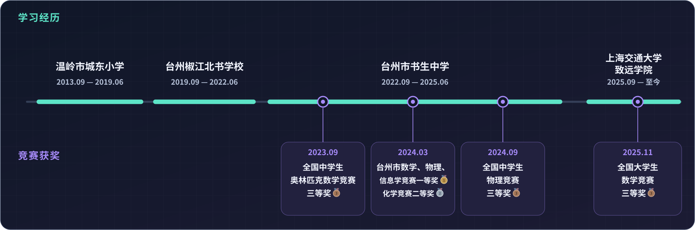
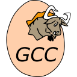

<strong>简体中文</strong> · <a href="./README-En.md">English</a>

  <picture>
    <source media="(prefers-color-scheme: light)" srcset="./assets/hero-light.svg" />
    
  </picture>

  <a href="https://readme-typing-svg.demolab.com">
    <picture>
      <source media="(prefers-color-scheme: light)" srcset="https://readme-typing-svg.demolab.com?font=Fira+Code&amp;size=20&amp;duration=2800&amp;pause=900&amp;color=167C74&amp;center=true&amp;vCenter=true&amp;width=700&amp;lines=Student+%40+SJTU+Zhiyuan+College;Building+plugins+and+useful+software;Explore+%E2%86%92+Build+%E2%86%92+Share" />
      
    </picture>
  </a>

  
  

  <picture>
    <source media="(prefers-color-scheme: light)" srcset="./assets/divider-light.svg" />
    
  </picture>

## 👋 关于我

我是**林函锋**（2007.07.31），上海交通大学 致远学院 计算机科学与技术 **JOHN 班** 学生

我来自浙江台州温岭，一座海边的小城，有很多美食。这里是古茗的发源地，也是其“宇宙总店”的所在地；城里还有一家新荣记（品牌发源于台州临海）。目前我长期在上海读书。

喜欢把学习和生活里的具体问题做成工具：铁路出行规划、VS Code 本地测评插件、课程学习资料等都是我在做的项目，也参与教学与教务软件开发，可以实际落地在学校中使用

平时对于有趣的思维问题、数学或编程问题比较感兴趣，常常自行钻研，欢迎一起分享探讨！

### 🎓 学习经历与竞赛获奖

<picture>
  <source media="(prefers-color-scheme: light)" srcset="./assets/timeline-medals-subtle-light.svg" />
  
</picture>

  <picture>
    <source media="(prefers-color-scheme: light)" srcset="./assets/divider-light.svg" />
    
  </picture>

## 🧩 我的项目

### 🚀 已结项

> 可能会有不定期的 debug 或 improve 更新

#### VS Code 插件

| 项目 | 简介 |
| --- | --- |
| 🧪 **CP Tester · VS Code 算法测评插件** · [Linux](https://github.com/serendipitylin0731/CP_Tester_Linux) / [Windows](https://github.com/serendipitylin0731/CP_Tester_Windows) | 独立开发的 VS Code 本地测评插件，支持 C、C++、Python；可手动添加用例或批量导入 `.in` / `.out` 数据，设置时间与内存限制，并查看每个测试点的结果、耗时和内存占用（奶龙狂喜 bushi） |
| 🟢 [Codex Quota Rings · VS Code 额度插件](https://github.com/serendipitylin0731/codex_usage) | 独立开发的 VS Code 插件，在状态栏与资源管理器中展示 Codex 5 小时和 7 天窗口的剩余额度、重置时间与次数；圆环区分已用和剩余额度，支持自动或手动刷新 |
| 📝 [Markdown Preview & Compiler](https://github.com/serendipitylin0731/markdown_preview-compiler) | 独立开发的 VS Code Markdown 编辑扩展，支持源码编辑、分屏预览、所见即所得编辑，以及 PDF 对照预览与导出 |
| 🔍 [Shit Code Detector](https://github.com/serendipitylin0731/shit-code_detector) | 独立开发的 VS Code 代码风格评分插件；扫描当前项目、编辑器单文件或 HTTPS Git 仓库，结合本地规则与可选 AI 审查给出 0–9 分，支持筛选规则、问题追溯和报告导出 |

#### 软件

| 项目 | 简介 |
| --- | --- |
| 🚄 [轨迹 · 铁路出行规划](https://github.com/serendipitylin0731/ticket_planner_realease) | 独立开发的 Web 与 Android 铁路出行规划工具；支持多组出发、到达及有序途径站，按日期查询 12306 实际车次，规划直达或最多 3 次换乘；结果分直达和中转展示，社区静态时刻表仅辅助搜索 |
| 🧭 [“3820”知识助手与战略推演平台](https://github.com/serendipitylin0731/3820_agent) | 中国教育技术协会——“AI+教育”创新应用技能大赛参赛作品，辅助《习近平新时代中国特色社会主义思想概论》课程教学；围绕福州“3820”战略工程，提供有来源的问答、指标查询与空间分析，并且允许直接检索现有资料 |
| 📖 [知页 TA Agent](https://github.com/serendipitylin0731/TA_agent) | 面向初高中师生的教材知识库与智能问答系统；接入 113 册教材，支持带教材与 PDF 页码来源的问答、原文检索和双页阅读 |
| 🏫 [教师出勤与工资统计程序](https://github.com/serendipitylin0731/Salary_Computing) | 基于 Tkinter 的本地桌面工具，为书生中学批量导入班级坐班统计表；自动核对节数、标记异常数据并辅助修正教师姓名，校验后预览津贴明细并导出 Excel 工资表 |

### 🏫 近期项目

- 担任 **2026 级致远学院 [JOHN 班程序设计与数据结构](https://github.com/SJTUJohnClass) 助教**，负责 [Gitlite：轻量级 Git 学习项目](https://github.com/serendipitylin0731/gitlite_2026_stu)，并讲解[分治算法与排序](https://github.com/serendipitylin0731/Documents/blob/main/Presentation/report-Divide%20and%20Conquer.pdf)、[搜索算法](https://github.com/serendipitylin0731/Documents/blob/main/Presentation/report_search-2026.pptx)
- 开发和定制教务排课系统模板；项目暂未开源，欢迎通过邮件交流
- 开发 [极速仓库](https://github.com/serendipitylin0731/QQspeed_gaming)：一款 QQ 飞车本地资料与赛事管理应用，整合地图和赛车图鉴、图池筛选与随机转盘、赛事计分台和战绩存档；数据在本地保存，可导出备份

### 📚 资料分享

**[计算机入门讲义](https://github.com/serendipitylin0731/Instuction)：** 独立编写的零基础工具指南，涵盖 Markdown、LaTeX、正则表达式、Mermaid、Git 与 WSL；既可按步骤入门，也可在 GitHub 直接阅读并作为速查手册使用。

我的一些报告演示文档、演示海报、研究相关文章，以及高中可用的一些资料保存在 [Documents 仓库](https://github.com/serendipitylin0731/Documents)，欢迎参考。

### 🛠️ 技术与工具

  <picture>
    <source media="(prefers-color-scheme: light)" srcset="https://skillicons.dev/icons?i=c%2Ccpp%2Cpy%2Cjs%2Cbash%2Chtml%2Ccss%2Cmd%2Clatex%2Cvscode%2Cpycharm%2Cgit%2Ccmake%2Clinux%2Cnodejs%2Csqlite&amp;theme=light&amp;perline=8" />
    
  </picture>

  <picture><source media="(prefers-color-scheme: light)" srcset="./assets/skills-extra/windows11.svg" /></picture>
  
  <picture><source media="(prefers-color-scheme: light)" srcset="./assets/skills-extra/jupyter.svg" /></picture>
  
  <picture><source media="(prefers-color-scheme: light)" srcset="./assets/skills-extra/labview.svg" /></picture>
  <picture><source media="(prefers-color-scheme: light)" srcset="./assets/skills-extra/geogebra.svg" /></picture>
  

<strong>编程语言与网页</strong> · C · C++ · Python · JavaScript · Bash/Shell · HTML/CSS <strong>开发环境</strong> · VS Code · PyCharm · Node.js · WSL · Git · CMake · GCC <strong>数据与图示</strong> · Jupyter · SQLite · Origin · LabVIEW · GeoGebra · Mermaid <strong>文档</strong> · Markdown · LaTeX

  <picture>
    <source media="(prefers-color-scheme: light)" srcset="./assets/divider-light.svg" />
    
  </picture>

## 🎮 代码之外

除编程外，我也持续投入游戏、棋类、音乐与运动。

<table width="100%">
  <tr>
    <td align="center" width="33%"> <strong>🎮 游戏</strong></td>
    <td align="center" width="33%"> <strong>♟️ 文艺</strong></td>
    <td align="center" width="33%"> <strong>⚽ 运动</strong></td>
  </tr>
</table>

### 🎮 游戏

- **QQ 飞车** · UID `44758614`，iOS/QQ 账号，加入[车队 · 云曦](https://www.douyin.com/user/MS4wLjABAAAA5cQxzhgNTyrF6Nzu1o-rQjxXcQnFDkVfGVZofKXqukvKc4JqRauw4z-jXmtkR6JV)。多赛季稳定在千分车神以上，积极承担车队考核工作；全 T、全联赛账号，有组织比赛的经验，并熟悉 S-联赛。
  - **个人王图：** 特洛伊环城、流觞曲水、火星基地、赤城红叶。
  - **偏好地图：** 泰坦之巅、龙晶湖、八闽山海、雪境裂渊、踏雪寻春、浪漫海滨、秋名山、心渊、猫梦浮屋。
- **和平精英** · 连续多赛季达到高星王牌。主要担任指挥位，也能担任驾驶位与狙击位；喜欢经典海岛和山谷。超体对抗中主要使用幻影猎手、闪电尖兵，也能使用次元极客、战地医师补位；多次在线上小队竞赛中进入前三。
- **我的世界** · 喜欢研究红石，在生电与建筑方面也有一定经验；注重设计简单实用的红石机器，以及外观美观的基地和机器。
- **其他游戏与赛事** · 还接触皇室战争、王者荣耀、明日方舟、CSGO 等游戏；关注 QQ 飞车、王者荣耀、PUBG、CSGO 等项目的联赛。

### ♟️ 文艺

- **棋类：** 中国象棋、国际象棋、五子棋、斗兽棋、黑白棋，其中最擅长中国象棋。
- **乐器：** 架子鼓、陶笛、口琴、非洲鼓、尤克里里；主要擅长架子鼓，已获得六级证书。
- **其他爱好：** 书法、拼豆、魔方与美食等。

### ⚽ 运动

- **足球：** 司职守门员，门线技术较强，脚下技术仍需提升。
- **羽毛球：** 擅长网前小球与劈吊。
- **匹克球：** 课程双败淘汰赛季军。
- **乒乓球：** 有多年学习经验；小学乒乓球联赛获得温岭市团队八强、个人四强。
- **自行车：** 喜欢骑行。

  <picture>
    <source media="(prefers-color-scheme: light)" srcset="./assets/divider-light.svg" />
    
  </picture>

## 📬 联系我

有项目想法、课程交流或合作建议，欢迎通过以下方式联系我。也可以访问我的 [GitHub 主页](https://github.com/serendipitylin0731)。

- **个人邮箱：** [serendipity_lin@sjtu.edu.cn](mailto:serendipity_lin@sjtu.edu.cn)
- **云曦车队考核群 QQ：** 743475670
- **微信：** srendipity_Lin0731（添加时请注明你是谁和来意）

  <picture>
    <source media="(prefers-color-scheme: light)" srcset="./assets/endline-light.svg" />
    
  </picture>

